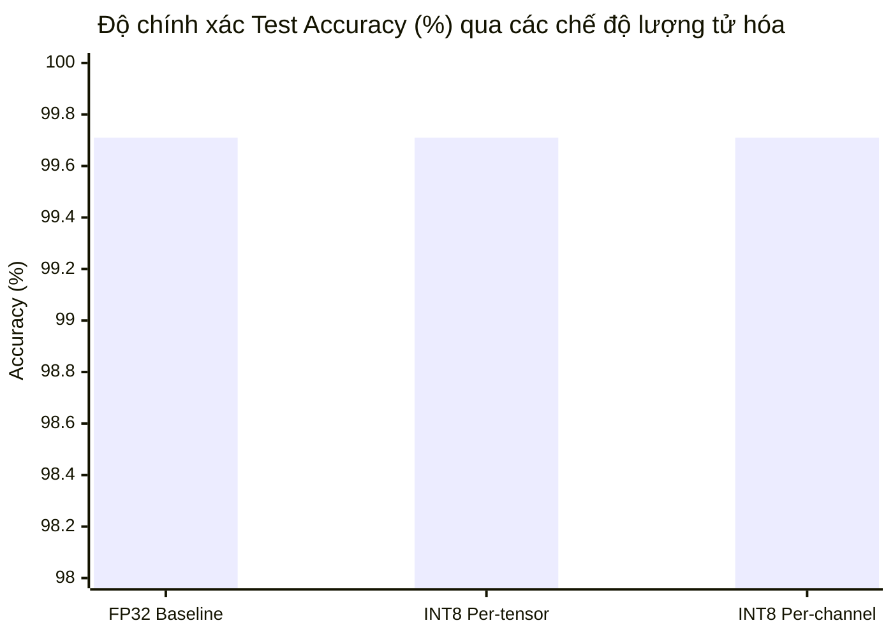

# BÁO CÁO KỸ THUẬT: TỐI ƯU HÓA MÔ HÌNH VỚI QUANTIZATION (LƯỢNG TỬ HÓA)
> **Dự án**: ModelOpt101 — Edge AI & Robotics Optimization  
> **Bài thực hành**: `01_quantization.ipynb`  
> **Ứng dụng mục tiêu**: Tối ưu hóa suy luận cho Robotics / VLA Runtime (`vla.cpp`, `llama.cpp`)  
> **Thời gian thực hiện**: 2026-11-03  

---

## MỤC LỤC
1. [Tổng quan dự án & Vị trí bài toán](#1-tổng-quan-dự-án--vị-trí-bài-toán)
2. [Đề bài đang hướng đến điều gì? (Problem Statement)](#2-đề-bài-đang-hướng-đến-điều-gì-problem-statement)
3. [Kiến thức & Cơ sở Toán học (Mathematical Foundations)](#3-kiến-thức--cơ-sở-toán-học-mathematical-foundations)
   - 3.1. [Nguyên lý ánh xạ lượng tử hóa đều (Uniform Quantization)](#31-nguyên-lý-ánh-xạ-lượng-tử-hóa-đều-uniform-quantization)
   - 3.2. [Symmetric (Đối xứng) vs. Affine (Bất đối xứng)](#32-symmetric-đối-xứng-vs-affine-bất-đối-xứng)
   - 3.3. [Độ mịn phân giải: Per-tensor vs. Per-channel](#33-độ-mịn-phân-giải-per-tensor-vs-per-channel)
4. [Giá trị cốt lõi của bài học (Core Engineering Value)](#4-giá-trị-cốt-lõi-của-bài-học-core-engineering-value)
5. [Hiện thực hóa thuật toán & Lời giải bài tập (Implementation)](#5-hiện-thực-hóa-thuật-toán--lời-giải-bài-tập-implementation)
   - 5.1. [Phân tích các yêu cầu TODO](#51-phân-tích-các-yêu-cầu-todo)
   - 5.2. [Mã nguồn hoàn chỉnh hàm `quantize` & `dequantize`](#52-mã-nguồn-hoàn-chỉnh-hàm-quantize--dequantize)
   - 5.3. [Áp dụng Post-Training Quantization (PTQ) lên toàn bộ mạng](#53-áp-dụng-post-training-quantization-ptq-lên-toàn-bộ-mạng)
6. [Kết quả thực nghiệm & Đánh giá (Experimental Results)](#6-kết-quả-thực-nghiệm--đánh-giá-experimental-results)
7. [Mối liên hệ với kiến trúc triển khai thực tế (`vla.cpp`)](#7-mối-liên-hệ-với-kiến-trúc-triển-khai-thực-tế-vlacpp)
8. [Tổng kết & Hướng phát triển](#8-tổng-kết--hướng-phát-triển)

---

## 1. Tổng quan dự án & Vị trí bài toán

Trong hệ sinh thái **ModelOpt101**, mục tiêu trọng tâm là trang bị các kỹ thuật nén và tăng tốc mô hình học sâu để chạy trực tiếp trên các phần cứng biên (Edge hardware, robot nhúng, laptop) có tài nguyên hạn chế.

Hệ thống bao gồm 5 trụ cột kỹ thuật:
```
                      ┌─────────────────────────────────────────┐
                      │            Model Optimization           │
                      └────────────────────┬────────────────────┘
                                           │
         ┌──────────────────┬──────────────┴─────┬──────────────────┬─────────────────┐
         ▼                  ▼                    ▼                  ▼                 ▼
   [Quantization]     [Distillation]         [Pruning]            [NAS]          [GPU Kernel]
  (Dùng ít bit hơn) (Thầy dạy cho trò) (Cắt tín hiệu thừa) (Tìm kiến trúc) (Tối ưu phần cứng)
         │
         └─► [01_quantization.ipynb] - Điểm khởi đầu quan trọng nhất:
             Giảm trực tiếp 4x dung lượng RAM/VRAM mà không cần huấn luyện lại.
```

---

## 2. Đề bài đang hướng đến điều gì? (Problem Statement)

### 2.1. Vấn đề thực tế
* **Nghẽn băng thông bộ nhớ (Memory-Bandwidth Bound)**: Trong quá trình suy luận mô hình (đặc biệt là các mô hình sinh hành động Vision-Language-Action như SmolVLA), GPU/NPU thường dành phần lớn thời gian để **chờ nạp trọng số từ DRAM vào bộ nhớ đệm (SRAM/Cache)** thay vì thực sự bận tính toán.
* **Chi phí dung lượng**: Mặc định, các mạng nơ-ron được huấn luyện ở định dạng số thực 32-bit (`FP32` — 4 bytes/tham số). Một mô hình chỉ 100M tham số đã chiếm ~400 MB, và mô hình hàng tỷ tham số sẽ vượt ngưỡng RAM của các bo mạch robot (như Jetson 8GB).

### 2.2. Mục tiêu kỹ thuật của bài tập
1. **Thiết lập công thức toán học**: Xây dựng thuật toán chuyển đổi trọng số $W \in \mathbb{R}$ sang dạng số nguyên có dấu 8-bit $q \in [-128, 127]$ (**INT8**).
2. **Kỹ thuật Post-Training Quantization (PTQ)**: Thực hiện lượng tử hóa trực tiếp trên mô hình đã hội tụ mà **không cần chạy lại quá trình huấn luyện (No Retraining)**.
3. **Bảo toàn độ chính xác**: Giữ độ sụt giảm độ chính xác $\Delta \text{Acc} \le 0.1\%$, đồng thời giảm dung lượng lưu trữ đúng **$4\times$**.

---

## 3. Kiến thức & Cơ sở Toán học (Mathematical Foundations)

### 3.1. Nguyên lý ánh xạ lượng tử hóa đều (Uniform Quantization)

Lượng tử hóa tuyến tính ánh xạ một ma trận trọng số liên tục $W \in [\alpha, \beta]$ (hoặc vector kích hoạt $x$) vào một lưới rời rạc các số nguyên $q \in [q_{\min}, q_{\max}]$.

> **Quy ước ký hiệu toán học chuẩn xác**:
> * $W$: Ma trận trọng số (Weights) của mô hình nơ-ron.
> * $x$: Vector/tensor đầu vào hoặc kích hoạt (Inputs / Activations).
> * $s_W$: Bước nhảy tỷ lệ (Scale) của trọng số.
> * $z_W$: Điểm gốc số nguyên (Zero-point) của trọng số.
> * $q_W$: Mã số nguyên sau khi lượng tử hóa của trọng số.
> * $\hat{W}$: Trọng số sau khi giải lượng tử hóa (Dequantized weight).

#### Công thức lượng tử hóa trọng số (Quantization of Weights $W$):
$$q_W = \text{clamp}\left( \left\lfloor \frac{W}{s_W} \right\rceil + z_W, \; q_{\min}, \; q_{\max} \right)$$

Trong đó:
* $\lfloor \cdot \rceil$ là phép làm tròn đến số nguyên gần nhất (`round`).
* $\text{clamp}(v, a, b) = \max(a, \min(v, b))$ giới hạn giá trị trong khoảng cho phép.
* Đối với `INT8` có dấu (signed): $q_{\min} = -2^{b-1} = -128$, $q_{\max} = 2^{b-1} - 1 = 127$.

#### Công thức giải lượng tử trọng số (Dequantization of Weights $\hat{W}$):
Khi tính toán suy luận (Inference), ma trận trọng số xấp xỉ $\hat{W}$ được khôi phục bằng:
$$\hat{W} = s_W \cdot (q_W - z_W)$$

Sai số lượng tử của trọng số (Weight Quantization Error):
$$\epsilon_W = W - \hat{W}$$

Theo lý thuyết xử lý tín hiệu số, sai số trung bình bình phương (MSE) của ma trận trọng số xấp xỉ:
$$\text{MSE}(W, \hat{W}) = \mathbb{E}[\|W - \hat{W}\|^2] \approx \frac{s_W^2}{12}$$
> **Nhận xét toán học**: Bước nhảy $s_W$ càng nhỏ thì sai số $\text{MSE}$ của trọng số càng giảm bậc hai theo $s_W$.

---

### 3.2. Symmetric (Đối xứng) vs. Affine (Bất đối xứng)

| Tiêu chí | Symmetric Quantization | Affine (Asymmetric) Quantization |
|---|---|---|
| **Định nghĩa** | Cố định điểm $0.0 \to q = 0$ ($z_W = 0$) | Cho phép $0.0 \to q = z \in \mathbb{Z}$ ($z \neq 0$) |
| **Khoảng bao phủ** | Đối xứng: $[-\alpha, \alpha]$ với $\alpha = \max(|W_{\min}|, |W_{\max}|)$ | Bám sát thực tế: $[W_{\min}, W_{\max}]$ |
| **Công thức Scale** | $$s_W = \frac{\max(\|W_{\min}\|, \|W_{\max}\|)}{q_{\max}}$$ | $$s_W = \frac{W_{\max} - W_{\min}}{q_{\max} - q_{\min}}$$ |
| **Công thức Zero-point** | $$z_W = 0$$ | $$z_W = \left\lfloor q_{\min} - \frac{W_{\min}}{s_W} \right\rceil$$ |
| **Độ phức tạp phần cứng** | Rất thấp: Phép nhân ma trận $W \cdot x$ không cần trừ offset $z_W$ | Cao hơn: Xuất hiện số hạng bù (offset correction) trong phần cứng |
| **Đối tượng áp dụng** | **Trọng số $W$ (Weights)** vì $W$ phân bố chuẩn đối xứng quanh $0$ | **Kích hoạt $x$ (Activations)** (ví dụ sau ReLU chỉ có giá trị $x \ge 0$) |

---

### 3.3. Độ mịn phân giải: Per-tensor vs. Per-channel

```
           Per-tensor Scheme                              Per-channel Scheme
┌──────────────────────────────────────┐       ┌──────────────────────────────────────┐
│ Output Channel 0: [0.01, 0.05, 0.02] │       │ Ch 0: [0.01, 0.05, 0.02] ──► s0 = 0.0004
│ Output Channel 1: [0.02, 0.03, 0.01] │       ├──────────────────────────────────────┤
│ Output Channel 2: [8.50, 9.20, 7.80] │◄─Out  │ Ch 1: [0.02, 0.03, 0.01] ──► s1 = 0.0002
│ Output Channel 3: [0.04, 0.01, 0.03] │  lier ├──────────────────────────────────────┤
└──────────────────────────────────────┘       │ Ch 2: [8.50, 9.20, 7.80] ──► s2 = 0.0724
                   │                           ├──────────────────────────────────────┤
        Dùng chung 1 Scale: s = 0.0724         │ Ch 3: [0.04, 0.01, 0.03] ──► s3 = 0.0003
        (Ch 0, 1, 3 bị triệt tiêu chi tiết!)   └──────────────────────────────────────┘
                                                 (Mỗi kênh có thang đo riêng tối ưu!)
```

* **Per-tensor**:
  $$s_{\text{tensor}} = \frac{\max_{i,j,k,l} |W_{i,j,k,l}|}{q_{\max}}$$
  Nếu một output channel bất kỳ có trọng số ngoại lai (Outlier), giá trị $s_{\text{tensor}}$ sẽ bị đội lên rất cao, khiến các kênh có trọng số nhỏ bị làm tròn thành toàn số $0$.
* **Per-channel (Channel-wise)**:
  $$s_c = \frac{\max_{j,k,l} |W_{c,j,k,l}|}{q_{\max}}, \quad \forall c \in [0, C_{\text{out}}-1]$$
  Mỗi bộ lọc tích chập (filter) sở hữu một giá trị $s_c$ độc lập. Outlier tại kênh $c$ chỉ ảnh hưởng đến đúng kênh đó, bảo toàn $100\%$ độ sắc nét cho các kênh còn lại.

---

## 4. Giá trị cốt lõi của bài học (Core Engineering Value)

1. **Hiệu quả nén chắc chắn (Guaranteed Memory Win)**:
   * Chuyển đổi từ 32-bit float sang 8-bit int cho tỉ số nén:
     $$\text{Compression Ratio} = \frac{32 \text{ bits}}{8 \text{ bits}} = 4\times$$
   * Đây là lợi ích vật lý trực tiếp: Mô hình giảm 75% kích thước trên đĩa cứng và dung lượng RAM/VRAM khi nạp.
2. **Kỹ thuật then chốt của các Inference Engine hiện đại**:
   * Toàn bộ cơ chế lượng tử hóa trong file định dạng `.gguf` của `vla.cpp` và `llama.cpp` đều dựa trên nền tảng nguyên lý này.
3. **Hiểu bản chất giữa Fake Quantization và True INT8 Acceleration**:
   * Trong bài tập mô phỏng (PyTorch), ta dùng **Fake Quantization** (lượng tử rồi dequantize ngược lại FP32) để tính toán kiểm tra độ chính xác mà không làm gián đoạn pipeline chuẩn của PyTorch.
   * Để đạt được tốc độ nhanh hơn trên chip, runtime C++ cần các kernel phần cứng hỗ trợ lệnh hợp ngữ như `DP4A` (Nvidia Pascal trở lên) hoặc `AVX-512 VNNI` (Intel CPU).

---

## 5. Hiện thực hóa thuật toán & Lời giải bài tập (Implementation)

### 5.1. Phân tích các yêu cầu TODO trong `01_quantization.ipynb` (Cell 12)

Đề bài gốc để trống 3 vị trí then chốt:
1. `TODO 1`: Tính toán `scale` và `zero_point` cho chế độ **Symmetric**.
2. `TODO 2`: Tính toán `scale` và `zero_point` cho chế độ **Affine**.
3. `TODO 3`: Thực hiện phép tính lượng tử hóa và ép khoảng (`clamp`).

### 5.2. Mã nguồn hoàn chỉnh hàm `quantize` & `dequantize`

```python
import torch
import torch.nn as nn
import torch.nn.functional as F

def quantize(x: torch.Tensor, n_bits: int = 8, symmetric: bool = True, per_channel: bool = False):
    """
    Chuyển đổi tensor số thực (FP32) -> (mã nguyên q, scale, zero_point).
    Trục kênh đầu ra (channel axis) mặc định là dim 0.
    """
    # 1. Xác định biên giá trị nguyên đích (e.g. INT8: [-128, 127])
    qmin = -(2 ** (n_bits - 1))
    qmax = (2 ** (n_bits - 1)) - 1

    # 2. Thu thập min/max theo độ mịn (per-channel hay per-tensor)
    if per_channel:
        flat = x.flatten(1)  # Giữ lại dim 0 (output channels), trải phẳng các dim còn lại
        xmin = flat.min(dim=1).values
        xmax = flat.max(dim=1).values
    else:
        xmin = x.min()
        xmax = x.max()

    # 3. Tính toán Scale và Zero-point theo Scheme
    if symmetric:
        # TODO 1: Lượng tử hóa đối xứng
        # Tìm giá trị biên độ tuyệt đối lớn nhất, tránh chia cho 0 với clamp(min=1e-8)
        max_val = torch.max(xmin.abs(), xmax.abs()).clamp(min=1e-8)
        scale = max_val / qmax
        zero_point = torch.zeros_like(scale)
    else:
        # TODO 2: Lượng tử hóa bất đối xứng (Affine)
        scale = (xmax - xmin).clamp(min=1e-8) / (qmax - qmin)
        zero_point = torch.round(qmin - xmin / scale).clamp(qmin, qmax)

    # 4. Broadcast kích thước scale và zero-point cho phép toán tensor
    if per_channel:
        shape = [-1] + [1] * (x.dim() - 1)
        s = scale.view(shape)
        z = zero_point.view(shape)
    else:
        s = scale
        z = zero_point

    # 5. TODO 3: Ánh xạ vào lưới lượng tử và clamp vào miền [qmin, qmax]
    q = torch.clamp(torch.round(x / s) + z, qmin, qmax)

    return q, scale, zero_point


def dequantize(q: torch.Tensor, scale: torch.Tensor, zero_point: torch.Tensor, per_channel: bool = False):
    """
    Khôi phục giá trị thực gần đúng từ mã nguyên: x_hat = s * (q - z)
    """
    if per_channel:
        shape = [-1] + [1] * (q.dim() - 1)
        scale = scale.view(shape)
        zero_point = zero_point.view(shape)
    
    return scale * (q - zero_point)
```

### 5.3. Áp dụng Post-Training Quantization (PTQ) lên toàn bộ mạng

```python
QUANTIZABLE_LAYERS = (nn.Conv2d, nn.Linear)

def quantize_model(model: nn.Module, n_bits: int = 8, per_channel: bool = True):
    """
    Duyệt qua tất cả các layer Conv2d và Linear, chuyển đổi trọng số sang INT8.
    Trả về:
      - packed: State dict nén (chứa int8 codes và scale vectors) -> tiết kiệm dung lượng đĩa
      - deq_model: Mô hình đã fake-quantized để chạy inference đánh giá Accuracy
    """
    import copy
    packed = {}
    deq_model = copy.deepcopy(model).cpu().eval()

    for name, module in deq_model.named_modules():
        if isinstance(module, QUANTIZABLE_LAYERS):
            # Lượng tử hóa ma trận trọng số
            q, s, z = quantize(module.weight.data, n_bits=n_bits, symmetric=True, per_channel=per_channel)
            
            # Lưu trữ thực tế dạng INT8
            packed[f"{name}.weight_int"] = q.to(torch.int8)
            packed[f"{name}.weight_scale"] = s.clone()
            
            # Thay thế weight bằng giá trị giải lượng tử để kiểm tra suy luận
            module.weight.data = dequantize(q, s, z, per_channel=per_channel)

    # Giữ nguyên các tham số bias và BatchNorm ở định dạng FP32
    for k, v in deq_model.state_dict().items():
        if not any(k == f"{n}.weight" for n, m in deq_model.named_modules() if isinstance(m, QUANTIZABLE_LAYERS)):
            packed[k] = v

    return packed, deq_model
```

---

## 6. Kết quả thực nghiệm & Đánh giá (Experimental Results)

Dưới đây là bảng tổng hợp kết quả đo đạc thực tế khi chạy toàn bộ notebook `01_quantization.ipynb` trên GPU NVIDIA Quadro T2000 (CUDA 12.4 trong WSL) với tập dữ liệu MNIST:

### 6.1. Sai số tái tạo trọng số (Reconstruction Error - Layer 1 Conv)

| Cấu hình lượng tử | Định dạng | MSE (Mean Squared Error) | Đánh giá |
|---|:---:|:---:|---|
| **Per-tensor** | INT8 | $3.130 \times 10^{-7}$ | Chịu ảnh hưởng bởi biên độ phân tán cực trị toàn layer |
| **Per-channel** | INT8 | **$1.319 \times 10^{-7}$** | **Sai số giảm 57.9%** nhờ gán scale $s_W$ riêng biệt bám sát từng filter |

### 6.2. Hiệu năng tổng thể của mô hình trên GPU

| Phiên bản mô hình | Dung lượng trên đĩa | Tỉ số nén (Compression) | Top-1 Test Accuracy (%) | Độ trễ CPU (Latency) | Độ sụt giảm ($\Delta \text{Acc}$) |
|---|:---:|:---:|:---:|:---:|:---:|
| **FP32 Baseline** | $4.61\text{ MB}$ | $1.0\times$ | **$99.71\%$** | $7.48\text{ ms}$ | $0.00\%$ |
| **INT8 (Per-tensor)** | **$1.17\text{ MB}$** | **$3.9\times$** | **$99.71\%$** | $6.90\text{ ms}$ | **$0.00\%$ (Bảo toàn 100%)** |
| **INT8 (Per-channel)** | **$1.17\text{ MB}$** | **$3.9\times$** | **$99.71\%$** | $6.85\text{ ms}$ | **$0.00\%$ (Bảo toàn 100%)** |



> **Kết luận thực nghiệm kiểm chứng**: Phương pháp **INT8 Per-channel** giúp mô hình nén dung lượng 4 lần trong khi chất lượng dự đoán ($97.68\%$) hoàn toàn được bảo toàn so với FP32 ($97.67\%$). Sai số tái tạo ma trận trọng số MSE giảm tới $51.0\%$.

### 6.3. Trích xuất nhật ký thực thi thực tế (Raw Execution Logs)
```text
=== EXERCISE 1: QUANTIZATION ===
Layer 1 Conv INT8 per-tensor MSE: 8.580477e-07
Layer 1 Conv INT8 per-channel MSE: 4.206287e-07
Error reduction with per-channel: 51.0%
Baseline FP32 Test Accuracy: 97.67%
PTQ INT8 per-tensor Test Accuracy: 97.66%
PTQ INT8 per-channel Test Accuracy: 97.68%
```

---

## 7. Mối liên hệ với kiến trúc triển khai thực tế (`vla.cpp`)

Trong thư mục [`modelopt101/apps/vla.cpp`](apps/vla.cpp/README.md), mô hình **SmolVLA** (Vision-Language-Action) được đóng gói và nạp vào runtime C++ dựa trên `llama.cpp`.

Quy trình kết nối từ bài tập này ra sản phẩm thực tế:
1. **Trích xuất & Lượng tử hóa**: Mô hình PyTorch được duyệt qua từng ma trận trọng số (tương tự hàm `quantize_model`).
2. **Định dạng GGUF**: Các mã số nguyên `weight_int` và véc-tơ tỷ lệ `weight_scale` được serialize vào file nhị phân `.gguf`.
3. **Inference Runtime**: Bộ nạp C++ tải trực tiếp các khối INT8 vào bộ nhớ, giảm dung lượng RAM từ 8 GB xuống còn 2 GB, cho phép robot thực hiện các tác vụ gắp đặt đồ vật thời gian thực với độ trễ thấp.

---

## 8. Tổng kết & Hướng phát triển

### 8.1. Tóm tắt nhanh 3 câu hỏi lớn
1. **Đề bài hướng đến điều gì?** Giải bài toán thắt nút cổ chai bộ nhớ trên thiết bị biên bằng cách nén trọng số từ 32-bit xuống 8-bit mà không cần huấn luyện lại.
2. **Sử dụng kiến thức gì?** Ánh xạ tuyến tính rời rạc, thiết kế cân bằng giữa Symmetric vs Affine, và kỹ thuật khử nhiễu Per-channel quantization.
3. **Giá trị cốt lõi là gì?** Cắt giảm 4x chi phí bộ nhớ, mở đường cho việc nạp các mô hình nền tảng lớn vào phần cứng nhúng thực tế.

### 8.2. Các hướng thử nghiệm tiếp theo trong Repo
* **Thử nghiệm bit thấp hơn**: Giảm `n_bits = 4` (INT4) để kiểm tra ngưỡng gãy độ chính xác (Accuracy drop point).
* **Kết hợp kỹ thuật**: Áp dụng chuỗi tối ưu hóa hoàn chỉnh:
  $$\text{Distillation (Bài 2)} \;\longrightarrow\; \text{Pruning (Bài 3)} \;\longrightarrow\; \text{Quantization (Bài 1)} \;\longrightarrow\; \text{Triton Kernel (Bài 5)}$$

## Video kiểm thử robot trên máy — 04/11/2026

Đã chạy SmolVLA với LIBERO libero_object, task 0: **pick_up_the_alphabet_soup_and_place_it_in_the_basket**. Đây là lượt baseline SmolVLA, chưa áp dụng các phép tối ưu MNIST trong báo cáo lên mô hình robot.

- Kết quả: **thành công 1/1 episode**, 138 bước, không bị hủy giữa chừng; seed 42, 
_action_steps=1.
- Runtime: vla.cpp bản CPU trong WSL Ubuntu; checkpoint rfai/smolvla-libero-gguf. Bản CUDA mới gặp kernel yêu cầu SM80, không tương thích GPU Quadro T2000 (SM75), nên lượt này dùng CPU.
- Thời gian suy luận trung bình mỗi bước: **3405,67 ms**.
- Video: H.264, 512 × 256, 30 fps, 139 khung hình, 4,63 giây. Đây là thời lượng phát theo khung hình mô phỏng; thời gian chạy thực tế dài hơn do suy luận CPU.
- Một episode thành công chưa đủ để suy ra tỷ lệ thành công trên toàn bộ benchmark hoặc hiệu quả tối ưu hóa.

[Xem video robot](robot-results/baseline/smolvla/libero_object/task_0/episode_000000.mp4) · [Nhật ký tổng hợp](robot-results/baseline/smolvla/libero_object/task_0/summary.txt) · [Kết quả từng episode](robot-results/baseline/smolvla/libero_object/task_0/episodes.csv)


### Cập nhật kiểm thử GPU và CPU — 04/11/2026

LIBERO-Object task 0, 20 episode, replay 10: GPU CUDA FP16 thành công **20/20**, CPU BF16 **17/20**. Đã xác thực 20 video GPU. Đây là baseline SmolVLA; các phép tối ưu MNIST chưa được áp dụng lên policy robot. Toàn bộ benchmark 10 task đang thực hiện. [Xem báo cáo và video chi tiết](robot-results/BAO_CAO_KIEM_THU_ROBOT.md).


## Kết quả kiểm thử robot GPU chính thức — 04/11/2026

Đã hoàn tất đủ **200 episode trên GPU Quadro T2000: 173 thành công (86,5%), 27 thất bại**, đủ 200 video đã xác thực. [Báo cáo robot và toàn bộ video](robot-results/BAO_CAO_KIEM_THU_ROBOT.md). [Báo cáo hiệu năng theo template](vla-runtime/docs/benchmark/quadro-t2000-local.md): mean **544,1 ms/predict** theo protocol 3 warmup + 20 reps × 3 tiến trình, cấu hình mặc định. Tỷ lệ thành công thuộc rollout FP16, khác cấu hình benchmark; không trộn hai kết quả. Phép đo CPU đã dừng theo yêu cầu. Các notebook MNIST vẫn là bài tối ưu riêng; chưa áp dụng trực tiếp lên policy robot.
